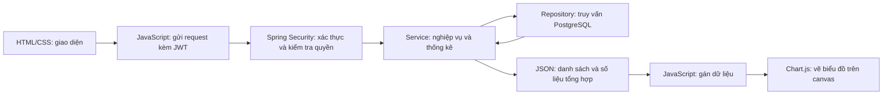

# FinanceManagement — MVP và kế hoạch triển khai

Cập nhật: 14/10/2026. Tài liệu dựa trên mã nguồn hiện tại, không phải kết quả chạy ứng dụng hay kiểm thử. Các API ghi “đề xuất” chưa được triển khai.

## 1. Sản phẩm cần giải quyết việc gì?

Một ứng dụng chi tiêu cá nhân giúp người dùng xem các khoản đã chi, biết tiền đi vào những danh mục nào và so sánh chi tiêu giữa các tháng.

MVP tập trung vào dashboard, danh sách chi tiêu và hai biểu đồ. Nhập tay là nguồn dữ liệu tối thiểu. Giọng nói và phân loại bằng AI để sau MVP; các phần gọi OpenAI hiện đang bị comment.

Hành trình người dùng:

1. Đăng ký, đăng nhập.
   2. Thêm khoản chi gồm số tiền, danh mục, mô tả và ngày chi.
   3. Chọn tháng để xem danh sách và tổng chi tiêu.
   4. Xem biểu đồ tròn theo danh mục trong tháng đã chọn.
   5. Xem biểu đồ cột so sánh 12 tháng trong năm đã chọn.
   6. Sửa hoặc xóa khoản chi nhập sai; dữ liệu danh sách và thống kê được tải lại.

## 2. Hiện trạng dự án

| Phần | Hiện tại | Việc còn thiếu |
|---|---|---|
| Đăng ký | Có validation, kiểm tra email trùng, BCrypt | Chuẩn hóa lỗi trùng email khi xảy ra đồng thời |
| Đăng nhập | AuthenticationManager kiểm tra, trả JWT | Chuẩn hóa lỗi 401; bỏ dependency/biến không dùng |
| JWT | Có ký, hết hạn 1 giờ, filter, stateless | Secret đang nằm trong source; xử lý lỗi filter chưa đầy đủ |
| Quyền sở hữu | Có UserAccessService; đã gọi trong luồng chi tiêu, thông tin user, tổng chi | Báo cáo tháng chưa gọi checkOwner() |
| Tạo khoản chi | Có category, amount, description, expenseDate tùy chọn | Thống nhất validation số tiền/ngày chi |
| Danh sách | Có trả ExpenseResponse | Chưa có ngày chi trong response, lọc tháng, phân trang, sắp xếp |
| Cập nhật/xóa chi tiêu | Có UpdateExpenseRequest | Chưa có endpoint và method nghiệp vụ; DTO chưa có expenseDate |
| Báo cáo | Có tổng toàn bộ và tổng một tháng | Ranh giới Between, validation tháng, tổng theo danh mục, tổng nhiều tháng |
| Frontend | voice.html chuyển lời nói thành văn bản | Chưa có login/dashboard hoặc gọi API chi tiêu |
| Kiểm thử | Chỉ contextLoads() | Chưa kiểm thử nghiệp vụ, quyền truy cập, ranh giới tháng |

Chi tiết các vị trí cần sửa nằm trong [REVIEW.md](C:/Users/84966/E-commerce-java-springboot/FinanceManagement/docs/REVIEW.md).

## 3. Phạm vi MVP

### Bắt buộc

- Đăng ký/đăng nhập, xử lý token hết hạn.
  - Mỗi tài khoản chỉ thao tác với dữ liệu của mình.
  - Xem danh sách theo tháng, ngày mới nhất trước, có phân trang.
  - Thêm/sửa/xóa khoản chi thủ công.
  - Hiển thị tổng chi tháng và tổng chi năm đã chọn.
  - Biểu đồ tròn: tỷ trọng các danh mục trong tháng đã chọn.
  - Biểu đồ cột: tổng tiền từng tháng trong một năm.
  - Có trạng thái đang tải, không có dữ liệu, lỗi, xác thực hết hạn.
  - Giao diện sử dụng được trên desktop và điện thoại.

### Sau MVP

- Giọng nói, tự phân loại văn bản, tích hợp AI.
  - Ngân sách, thu nhập, nhắc nhở, xuất Excel/PDF.
  - Admin, nhiều loại tiền, kết nối ngân hàng, realtime.
  - Refresh token và quản lý nhiều phiên đăng nhập nếu phát sinh nhu cầu.

## 4. Công nghệ đề xuất

| Thành phần | Chọn cho MVP | Lý do |
|---|---|---|
| Backend | Spring Boot / Spring Security / JPA hiện tại | Tiếp tục nền tảng đã có |
| Database | PostgreSQL | Project đã khai báo driver |
| Frontend | HTML + CSS + JavaScript thuần | Phù hợp người đang học, cấu trúc hiện tại đã có static HTML |
| Gọi API | fetch() | JavaScript đọc JSON từ backend |
| Biểu đồ | Chart.js | Có doughnut/pie và bar; giấy phép MIT |
| Triển khai ban đầu | Static frontend cùng Spring Boot | Một ứng dụng, cùng origin, không cần cấu hình CORS cho luồng này |

Đây là lựa chọn dựa trên phạm vi dự án và mức kinh nghiệm hiện tại. Có thể chuyển sang React/Vue khi giao diện phát triển nhiều màn hình và trạng thái; việc chuyển đó không phải điều kiện hoàn thành MVP.

## 5. Backend và frontend chia việc như thế nào?



Backend cung cấp số liệu, không tạo ảnh biểu đồ. Frontend vẽ biểu đồ, không tự quyết định quyền truy cập hoặc cộng dữ liệu từ một trang danh sách để thay thế báo cáo toàn bộ.

Ví dụ danh sách chỉ tải 20 khoản chi/trang. Tổng tháng và các biểu đồ vẫn phải tính trên toàn bộ khoản chi thuộc khoảng thời gian đó, không chỉ trên 20 dòng đang hiển thị.

## 6. Quy tắc dữ liệu

- MVP dùng VND. Amount giữ BigDecimal ở Java/PostgreSQL; không dùng double để tính tiền.
  - Thống nhất precision/scale của cột amount và giới hạn đầu vào trước khi triển khai; ví dụ numeric(19,2) và validation tối đa 2 chữ số thập phân. Đây là thay đổi đề xuất, chưa có trong entity hiện tại.
  - expenseDate là thời điểm chi thực tế. createdAt là thời điểm bản ghi được tạo. Báo cáo dùng expenseDate.
  - MVP giữ LocalDateTime hiện tại và quy ước toàn bộ ngày/giờ là giờ Việt Nam, Asia/Ho_Chi_Minh. JSON dùng yyyy-MM-dd'T'HH:mm:ss, không thêm Z. Đây chưa phải mô hình nhiều múi giờ.
  - Không gửi expenseDate khi tạo: dùng giờ hiện tại theo múi giờ đã quy ước. Khi cập nhật mà không gửi ngày: giữ ngày cũ.
  - Tháng được tính bằng khoảng [đầu tháng, đầu tháng kế tiếp): >= start và < end.
  - Thống nhất category trong request/response ở đợt hoàn thiện contract. Enum gửi qua API, nhãn tiếng Việt và màu ổn định đặt ở frontend.
  - Biểu đồ tròn lấy tổng theo danh mục trong một tháng. Biểu đồ cột lấy tổng từng tháng trong một năm. Hai biểu đồ trả lời hai câu hỏi khác nhau.
  - Tháng không có chi tiêu: tổng bằng 0. Khi tổng tháng bằng 0, không chia phần trăm và không tạo biểu đồ tròn giả.

## 7. API hiện có và API cần bổ sung

Giữ đường dẫn /api/users/{userId} hiện tại để tránh đổi nhiều thứ cùng lúc. Mọi endpoint dữ liệu phải kiểm tra chủ sở hữu phía server. Nếu sau này chuyển sang /api/me, server vẫn cần kiểm tra quyền sở hữu khoản chi theo expenseId.

| Method | Endpoint | Trạng thái / nhiệm vụ |
|---|---|---|
| POST | /api/auth/register | Đã có |
| POST | /api/auth/login | Đã có, trả JWT |
| GET | /api/users/{userId} | Đã có, trả thông tin tài khoản của chính mình |
| POST | /api/users/{userId}/expenses | Đã có; đề xuất trả 201 và DTO có ngày chi |
| GET | /api/users/{userId}/expenses?year=2026&month=10&page=0&size=20 | Endpoint đã có; tham số lọc/phân trang là đề xuất, hiện chưa được xử lý |
| PUT | /api/users/{userId}/expenses/{expenseId} | Cần bổ sung |
| DELETE | /api/users/{userId}/expenses/{expenseId} | Cần bổ sung; thành công trả 204 |
| GET | /api/users/{userId}/reports/total | Đã có tổng toàn bộ; không phải tổng năm |
| GET | /api/users/{userId}/reports/monthly?year=2026&month=10 | Đã có, cần sửa quyền và ranh giới tháng |
| GET | /api/users/{userId}/reports/categories?year=2026&month=10 | Đề xuất: dữ liệu biểu đồ tròn |
| GET | /api/users/{userId}/reports/yearly?year=2026 | Đề xuất: dữ liệu biểu đồ cột và tổng năm |

### Response danh sách đề xuất

```json
{
  "items": [
    {
      "id": 10,
      "category": "FOOD_COFFEE",
      "amount": 50000,
      "description": "Ăn trưa",
      "expenseDate": "2026-10-12T12:00:00",
      "inputMethod": "MANUAL"
    }
  ],
  "page": 0,
  "size": 20,
  "totalElements": 1,
  "totalPages": 1
}
```

Đây là DTO phân trang ổn định do ứng dụng định nghĩa, không yêu cầu frontend phụ thuộc trực tiếp cấu trúc serialize nội bộ của Page. Sort theo expenseDate DESC, id DESC.

### Response biểu đồ tròn đề xuất

```json
{
  "year": 2026,
  "month": 10,
  "currency": "VND",
  "total": 1000000,
  "expenseCount": 3,
  "items": [
    { "category": "FOOD_COFFEE", "total": 600000 },
    { "category": "TRANSPORT", "total": 400000 }
  ]
}
```

SUM các items phải bằng total. Chart.js nhận số tiền tuyệt đối và biểu diễn tỷ trọng; nhãn phần trăm chỉ tính khi total > 0.

### Response biểu đồ cột đề xuất

```json
{
  "year": 2026,
  "currency": "VND",
  "total": 1500000,
  "months": [
    { "month": 1, "total": 500000 },
    { "month": 2, "total": 1000000 },
    { "month": 3, "total": 0 },
    { "month": 4, "total": 0 },
    { "month": 5, "total": 0 },
    { "month": 6, "total": 0 },
    { "month": 7, "total": 0 },
    { "month": 8, "total": 0 },
    { "month": 9, "total": 0 },
    { "month": 10, "total": 0 },
    { "month": 11, "total": 0 },
    { "month": 12, "total": 0 }
  ]
}
```

Các số trên là dữ liệu minh họa. Response thật luôn có 12 tháng theo thứ tự. Backend điền 0 cho tháng thiếu sau khi truy vấn, không gọi một API riêng cho từng tháng.

## 8. Truy vấn phục vụ thống kê

Tạo DTO/projection trong package report.dto cho tổng theo danh mục và tổng theo tháng. Repository thực hiện aggregate; ReportService kiểm tra quyền, kiểm tra năm/tháng, tạo khoảng thời gian và hoàn thiện response.

Ý tưởng SQL PostgreSQL cho biểu đồ tròn, chưa phải code chạy sẵn:

```sql
SELECT category, SUM(amount) AS total
FROM expenses
WHERE user_id = :userId
  AND expense_date >= :start
  AND expense_date < :end
GROUP BY category;
```

Ý tưởng cho biểu đồ cột:

```sql
SELECT EXTRACT(MONTH FROM expense_date)::integer AS month,
       SUM(amount) AS total
FROM expenses
WHERE user_id = :userId
  AND expense_date >= :yearStart
  AND expense_date < :nextYearStart
GROUP BY EXTRACT(MONTH FROM expense_date)
ORDER BY month;
```

Tham số phải được bind bởi repository; không nối SQL từ dữ liệu người dùng. Java giữ BigDecimal cho total, trả 0 thay cho SUM null khi không có bản ghi. Sau khi thống nhất truy vấn, cân nhắc index (user_id, expense_date) và quản lý schema bằng migration. Không gọi đây là N+1: vấn đề hiện tại là tải toàn bộ entity để cộng tổng, trong khi aggregate chỉ cần các số tổng.

## 9. Frontend đơn giản, phong cách công nghệ

### Màn hình

1. Login/register: form nhỏ, thông báo lỗi rõ, không cần dashboard nhiều trang.
   2. Dashboard: bộ chọn năm/tháng; tổng tháng và tổng năm; hai biểu đồ; danh sách chi tiêu; nút thêm khoản chi.
   3. Form thêm/sửa dạng dialog: số tiền, danh mục, mô tả, ngày chi. Xóa cần xác nhận để tránh bấm nhầm.

### Thiết kế

- Bề mặt trung tính, hỗ trợ sáng/tối; accent xanh tím, đường viền nhẹ.
  - Số tiền dùng tabular numbers; định dạng VND theo vi-VN.
  - Biểu đồ tròn dạng doughnut giúp đặt thông tin ở giữa; pie thường cũng dùng được.
  - Màu danh mục nhất quán giữa biểu đồ và chú giải. Biểu đồ cột dùng một màu chính, nổi bật tháng đang xem.
  - Desktop: hai biểu đồ cạnh nhau, bảng ở dưới. Mobile: xếp dọc, giữ số tiền/ngày đọc được.
  - Chọn tháng cập nhật danh sách, tổng tháng và doughnut. Chọn năm cập nhật dữ liệu 12 tháng. Cột là tổng cả tháng; không coi tháng chưa kết thúc là một tháng đầy đủ khi diễn giải.
  - Có trạng thái loading, empty, error và 401; tooltip VND; nhãn/danh sách thay thế để đọc được số liệu ngoài canvas.

### Cấu trúc file frontend đề xuất, chưa tạo

```text
src/main/resources/static/
  login.html
  register.html
  dashboard.html
  assets/
    css/app.css
    js/api.js
    js/auth.js
    js/dashboard.js
    js/charts.js
    js/expenses.js
    vendor/chart.umd.min.js
```

- app.css: bố cục, màu, responsive.
  - api.js: fetch chung, Bearer header, xử lý HTTP lỗi.
  - auth.js: login/register và trạng thái đăng nhập.
  - dashboard.js: năm/tháng, loading, kết nối các phần.
  - charts.js: tạo và cập nhật hai Chart instances.
  - expenses.js: danh sách, form và thao tác dữ liệu.

Thư viện Chart.js cần ghim phiên bản đã chọn, giữ thông tin license khi vendoring. Các đường dẫn trên là cấu trúc đề xuất, không phải file hiện có.

### Xác thực frontend

- HTML/CSS/JS tĩnh được truy cập để tải giao diện; API dữ liệu vẫn yêu cầu JWT và kiểm tra quyền. Đừng mở toàn bộ /api/** hoặc /** bằng permitAll().
  - MVP ban đầu có thể giữ JWT trong bộ nhớ JavaScript; reload thì đăng nhập lại. Đây là đánh đổi đơn giản để học, không phải cơ chế giữ phiên lâu dài.
  - Không cho rằng localStorage an toàn trước XSS. Nếu sau này dùng cookie HttpOnly để giữ phiên, phải thiết kế lại gửi token và bảo vệ CSRF tương ứng.
  - Đăng xuất ở client xóa token trong bộ nhớ, không thu hồi bản sao token còn hiệu lực ở nơi khác. MVP phải ghi nhận giới hạn này; muốn thu hồi ngay cần cơ chế phía server.
  - Cùng Spring Boot thì dùng URL tương đối và cùng origin. Nếu sau này tách dev server/frontend origin, cấu hình CORS và OPTIONS cụ thể.
  - Dữ liệu mô tả người dùng hiển thị bằng textContent hoặc render text an toàn, không chèn thẳng vào innerHTML.

### Gắn dữ liệu API vào Chart.js

Ví dụ nhận biến report từ API categories rồi vẽ doughnut:

```javascript
const chart = new Chart(canvasElement, {
  type: 'doughnut',
  data: {
    labels: report.items.map(item => item.category),
    datasets: [{ data: report.items.map(item => Number(item.total)) }]
  },
  options: { responsive: true }
});
```

Ví dụ bar: labels là T1 đến T12, data là yearlyReport.months.map(item => Number(item.total)), type: 'bar', scales.y.beginAtZero: true. Đổi tháng/năm thì cập nhật data của chart và gọi update(), hoặc destroy instance trước khi tạo mới. Number ở frontend chỉ phục vụ hiển thị; tính tiền vẫn ở backend.

## 10. Thứ tự làm tiếp

| Bước | Công việc | Điều kiện hoàn thành |
|---|---|---|
| 1 | Sửa báo cáo tháng thiếu quyền; cấu hình secret/lỗi xác thực | A không xem báo cáo B; token sai/hết hạn trả lỗi nhất quán |
| 2 | Hoàn thiện DTO ngày chi, lọc tháng, phân trang, sort | Danh sách trả đúng ngày/khoảng thời gian |
| 3 | Thêm cập nhật/xóa khoản chi | Kiểm tra cả userId lẫn chủ sở hữu expenseId |
| 4 | Sửa ranh giới tháng, validation year/month, chuyển tổng sang aggregate | Tổng đúng cả khi rỗng và tại thời điểm giao tháng |
| 5 | API categories và yearly | Tổng danh mục/tháng khớp dữ liệu; năm luôn có 12 tháng |
| 6 | Kiểm thử backend bằng dữ liệu có nhiều tháng và hai tài khoản | Các tình huống trong mục 11 đạt |
| 7 | HTML/CSS/JS + Chart.js | Dashboard hoạt động với API thật, dữ liệu không bị lẫn tài khoản |

Thiết kế bố cục có thể xem trước ngay; phần kết nối frontend triển khai cuối theo yêu cầu của bạn.

## 11. Tiêu chí nghiệm thu MVP

- A có thể thêm/sửa/xóa/xem khoản chi của A; A không thao tác với dữ liệu của B bằng cách đổi userId hoặc expenseId.
  - JWT sai, hết hạn, tài khoản bị xóa: không trả dữ liệu và không lỗi 500 ngoài ý muốn.
  - Trùng email, kể cả hai request đồng thời: không tạo hai tài khoản và có lỗi hợp lý.
  - Một khoản đúng 00:00 ngày đầu tháng sau chỉ thuộc tháng sau.
  - Báo cáo tháng/năm tính theo expenseDate, không theo createdAt.
  - Danh sách phân trang không làm tổng tháng bị tính thiếu.
  - Tổng categories bằng tổng tháng; tổng 12 tháng bằng tổng năm.
  - Không có chi tiêu: danh sách rỗng, tổng 0, biểu đồ tròn hiển thị empty state, không NaN/Infinity.
  - Sửa/xóa khoản chi cập nhật đúng dữ liệu và báo cáo sau khi tải lại.
  - Mô tả có ký tự HTML không được chạy như script trên frontend.
  - Giao diện không tràn ngang ở màn hình điện thoại, có nhãn và trạng thái lỗi rõ.

Chưa chạy những kiểm thử này trong lần đọc code hiện tại. Bộ test đang có chưa đủ xác nhận các tiêu chí trên.

## 12. Tài liệu chính thức

- [Chart.js: tổng quan và license MIT](https://www.chartjs.org/docs/latest/)
  - [Chart.js: doughnut và pie](https://www.chartjs.org/docs/latest/charts/doughnut.html)
  - [Chart.js: bar chart](https://www.chartjs.org/docs/latest/charts/bar.html)
  - [Chart.js: cập nhật dữ liệu](https://www.chartjs.org/docs/latest/developers/updates.html)
  - [Spring Data JPA: query methods](https://docs.spring.io/spring-data/jpa/reference/jpa/query-methods.html)
  - [Spring Security: authentication architecture](https://docs.spring.io/spring-security/reference/servlet/authentication/architecture.html)
